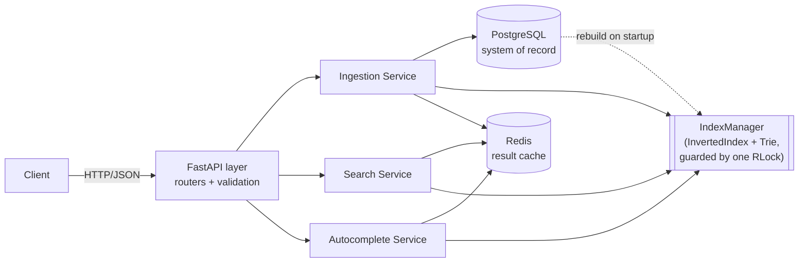

# SearchSphere — Scalable Search & Ranking Engine

A from-scratch search engine: a custom inverted index, a trie-based
autocomplete, BM25 relevance ranking, and heap-based Top-K retrieval, served
behind a FastAPI layer with PostgreSQL persistence and Redis caching.

Every core data structure (inverted index, trie, BM25 ranker, Top-K
selection) is implemented from first principles in [`app/core/`](app/core/)
— no search library, no `rank_bm25` package, no ElasticSearch. The goal is
to demonstrate the algorithms and the systems design around them, not to
wrap an existing engine.

## Table of contents

- [Problem statement](#problem-statement)
- [Architecture](#architecture)
- [Core algorithms & complexity](#core-algorithms--complexity)
- [API reference & examples](#api-reference--examples)
- [Concurrency & caching design](#concurrency--caching-design)
- [Setup](#setup)
- [CI/CD & Kubernetes deployment](#cicd--kubernetes-deployment)
- [Testing](#testing)
- [Benchmarks — methodology and actual results](#benchmarks--methodology-and-actual-results)
- [Limitations & future scaling work](#limitations--future-scaling-work)
- [Project layout](#project-layout)

## Problem statement

Build a search service that can:

1. Ingest text documents and make them searchable within the same request.
2. Rank results by relevance, not just presence, for multi-term queries.
3. Serve autocomplete suggestions ranked by popularity.
4. Paginate large result sets without re-scoring the entire corpus per page.
5. Stay correct under concurrent writers (duplicate ingestion races, reads
   during writes) and avoid serving stale cached results after a write.
6. Do all of the above with measured, reproducible performance numbers, not
   hand-waved complexity claims.

## Architecture



**Layering**, one responsibility each:

| Layer | Location | Responsibility |
|---|---|---|
| API | `app/api/` | Request validation (Pydantic), HTTP status codes, routing |
| Services | `app/services/` | Orchestration: cache lookup → index query → cache fill |
| Core | `app/core/` | Pure algorithms: tokenizer, inverted index, trie, BM25, Top-K |
| Storage | `app/storage/` | PostgreSQL models/repository, Redis cache wrapper |

PostgreSQL is the **system of record**; the in-memory `InvertedIndex` and
`Trie` are a derived, rebuildable view over it, hydrated once at process
startup (`app/main.py:_rebuild_index_from_database`) and kept in sync
incrementally as documents are ingested or deleted. If the process restarts,
nothing is lost — it just re-derives the index from Postgres.

## Core algorithms & complexity

| Component | File | Operation | Time | Space |
|---|---|---|---|---|
| Tokenizer | `app/core/tokenizer.py` | `tokenize(text)` | O(n) in text length | O(t) tokens |
| Inverted Index | `app/core/inverted_index.py` | `add_document` | O(u) unique terms | O(u) |
| | | `remove_document` | O(u) unique terms in that doc | — |
| | | `get_postings` / `document_frequency` | O(1) avg | — |
| | | `candidate_documents(terms)` | O(Σ df(t)) | O(candidates) |
| BM25 Ranker | `app/core/bm25.py` | `score_documents` (indexed) | O(Σ df(t) for t in query) | O(candidates) |
| | | `score_documents_linear_scan` (baseline) | O(N · \|Q\|) | O(N) |
| Trie | `app/core/trie.py` | `insert` | O(L) word length | O(L) new nodes |
| | | `suggest(prefix, k)` | O(P + M log k) | O(k) heap + O(P) recursion |
| Top-K | `app/core/topk.py` | `top_k_full_sort` | O(n log n) | O(n) |
| | | `top_k_heapq_nlargest` | O(n log k) | O(n) |
| | | `top_k_bounded_heap` | O(n log k) | **O(k)** |

Where `N` = corpus size, `u` = unique terms in a document, `df(t)` = document
frequency of term `t`, `M` = words under a trie prefix, `n` = candidate
documents for a query, `k` = page size.

**Why an inverted index beats a linear scan**: a linear scan must touch
every one of the `N` documents in the corpus for every query, regardless of
how selective the query is. The inverted index only ever touches documents
that contain at least one query term — for a query like `"quantum"` that
matches 15% of a corpus, the indexed path does roughly `0.15 × N` work
instead of `N` work, and that gap widens as the corpus grows while query
selectivity stays roughly constant. Measured numbers are in the
[benchmarks section](#benchmarks--methodology-and-actual-results) below.

**Why BM25** over raw term counting: term frequency alone over-rewards long
documents and repeated words. BM25 adds (a) inverse document frequency, so
rare/informative terms count more than common ones, and (b) length
normalization (the `b` parameter) and frequency saturation (the `k1`
parameter), so a document that mentions a term 50 times doesn't score 50×
higher than one that mentions it once — the returns diminish, matching how
relevance actually works.

**Why three Top-K implementations**: they're functionally identical (same
output, verified by `tests/unit/test_topk.py`) but trade off differently.
`top_k_bounded_heap` is used on the live query path because its *space* is
bounded by `k`, not `n` — for "page 1 of 10 results" over a 100k-candidate
query, it never materializes more than 10 heap slots. See the benchmark
below for where each implementation actually wins in practice (the
crossover is not where naive complexity analysis alone would suggest).

**Tie-breaking correctness**: all three Top-K functions must select the
*same set* of winners when scores tie, independent of `k` — otherwise
paginating with different page sizes can skip or repeat rows. This is
non-trivial to get right with a bounded heap (see the implementation
comment in `app/core/topk.py` and the regression test
`test_tied_scores_select_a_k_independent_prefix`); an earlier version of
this code had exactly this bug, caught by `test_pagination_offset_and_limit`
failing during development — the heap evicted based on raw `(score,
doc_id)` tuple order, which favors the *largest* doc_id on a tie, while the
final sort favors the *smallest* doc_id, so a 5-item window and a 10-item
window picked different documents for the same tied score.

## API reference & examples

Interactive OpenAPI docs are served at `/docs` once the app is running.

### Ingest a document

```bash
curl -X POST http://localhost:8000/documents \
  -H "Content-Type: application/json" \
  -d '{"title": "Intro to Python", "body": "Python is a general-purpose programming language."}'
```
```json
{"doc_id": 1, "title": "Intro to Python", "created": true}
```

Ingesting identical content again is idempotent (detected via a SHA-256
content hash with a unique database constraint — see
[Concurrency & caching design](#concurrency--caching-design)):
```json
{"doc_id": 1, "title": "Intro to Python", "created": false}
```

### Search

```bash
curl "http://localhost:8000/search?q=python&offset=0&limit=10"
```
```json
{
  "query": "python",
  "total": 1,
  "offset": 0,
  "limit": 10,
  "cache_hit": false,
  "results": [
    {"doc_id": 1, "title": "Intro to Python", "snippet": "Python is a general-purpose programming language.", "score": 0.628011}
  ]
}
```

### Autocomplete

```bash
curl "http://localhost:8000/autocomplete?prefix=pyt&limit=5"
```
```json
{"prefix": "pyt", "cache_hit": false, "suggestions": [{"term": "python", "frequency": 1}]}
```

### Fetch / delete a document

```bash
curl http://localhost:8000/documents/1
curl -X DELETE http://localhost:8000/documents/1   # 204 No Content
```

### Validation & error handling

| Scenario | Response |
|---|---|
| Blank/whitespace-only title or body | `422` with field-level detail |
| Empty or whitespace-only `q` | `422` |
| `limit` outside 1–100, negative `offset` | `422` |
| Document not found | `404` |
| Query matching no documents | `200` with `"results": []`, `"total": 0` |
| Query of only stopwords (e.g. `"the and or"`) | `200` with empty results (not an error — stopwords legitimately carry no signal) |
| Unhandled server error | `500` with a generic body (internals never leaked) |

## Concurrency & caching design

**Duplicate detection is race-safe, not just check-then-insert.** A SHA-256
hash of the normalized `(title, body)` pair has a unique index in
PostgreSQL. Ingestion attempts the `INSERT` directly; if two requests race
to insert identical content, the database's unique constraint — not
application logic — guarantees only one wins, and the loser's
`IntegrityError` is caught and turned into an idempotent "already exists"
response (`app/storage/repository.py:create_document`). This is verified
under real concurrency in
`tests/integration/test_concurrency.py::test_concurrent_duplicate_ingestion_creates_exactly_one_document`
(10 simultaneous identical POSTs → exactly one `created: true`).

**The in-memory index is guarded by a single `threading.RLock`.** Every
read (search, autocomplete) and write (add/remove document) acquires the
same lock, so no request ever observes a half-updated index (postings
updated but the document-snippet store not yet, or vice versa). This
serializes access rather than maximizing read concurrency — a deliberate,
documented trade-off; see [Limitations](#limitations--future-scaling-work).

**Cache invalidation is O(1), not scan-and-delete.** Every cached
search/autocomplete response is keyed with a monotonically increasing
"index version" fetched from Redis. Mutating the index (`INCR` on that
version key — atomic, so safe under concurrent writers) makes every
previously-cached key's version segment stale; stale keys are never looked
up again and simply expire on their TTL. No `SCAN`/`DEL` pass over
potentially thousands of keys is ever needed. See
`app/storage/cache.py:ResultCache`.

## Setup

### Prerequisites
Python 3.13, PostgreSQL, Redis — either natively installed or via Docker.

### Option A — Docker Compose (recommended for a clean checkout)

```bash
cp .env.example .env
docker compose up --build
```

This starts PostgreSQL, Redis, and the API (port 8000) together; the API
waits for both dependency health checks before starting.

### Option B — Local services

```bash
python3 -m venv .venv && source .venv/bin/activate
pip install -r requirements-dev.txt

cp .env.example .env   # adjust DATABASE_URL / REDIS_URL if needed

uvicorn app.main:app --reload
```

### Load the sample dataset

```bash
python scripts/generate_sample_data.py      # writes data/sample_documents.json (deterministic, seeded)
python scripts/seed_db.py --reset           # loads it into PostgreSQL + the live index
```

## CI/CD & Kubernetes deployment

[`.github/workflows/ci-cd.yml`](.github/workflows/ci-cd.yml) runs on every
push/PR to `main`:

1. **`test`** — the full suite (`pytest tests/ -v --cov=app`) against real
   Postgres/Redis service containers, not mocks.
2. **`docker-build`** — the image builds cleanly (runs on PRs too, no
   registry credentials needed).
3. **`publish`** *(push to `main` only, after 1 and 2 pass)* — builds and
   pushes `ghcr.io/nikanwar3/searchsphere` to GitHub Container Registry,
   tagged `latest` and the commit SHA, using the workflow's own
   `GITHUB_TOKEN` (no registry secrets to manage). A final step rolls the
   image out to a live cluster via `kubectl apply -k k8s/`, but only runs
   if a `KUBE_CONFIG_DATA` secret is configured — the image still publishes
   either way.

[`k8s/`](k8s/) holds the Kubernetes manifests (Deployment/Service for the
API, self-contained Postgres/Redis, ConfigMap, optional Ingress, tied
together with a `kustomization.yaml`). See [`k8s/README.md`](k8s/README.md)
for `kubectl apply` instructions — including **why the API Deployment is
pinned to `replicas: 1`**, which ties directly into the in-memory-index
limitation covered below.

## Testing

```bash
pytest tests/ -v                              # 96 tests
pytest tests/ --cov=app --cov-report=term-missing   # with coverage
```

Unit tests (`tests/unit/`) exercise the core algorithms in isolation, with
no external services. Integration tests (`tests/integration/`) run the real
FastAPI app against a real PostgreSQL database and real Redis instance
(connection info from `DATABASE_URL`/`REDIS_URL`, defaulting to
`.env.example`'s values) and cover:

- Empty / whitespace-only queries and bodies (`422`)
- Duplicate document ingestion (race-free idempotency, with and without
  case/whitespace differences)
- Missing documents (`404`)
- Cache hit/miss transitions and invalidation on ingest and delete
- Pagination correctness, including the tied-score edge case described above
- Concurrent duplicate ingestion, concurrent distinct ingestion, and mixed
  concurrent reads/writes (`tests/integration/test_concurrency.py`)

**Actual result from this repository** (Python 3.13.5, Apple M1):

```
96 passed in 2.83s
---------- coverage: 97% (639 statements, 21 missed) ----------
```

## Benchmarks — methodology and actual results

All numbers below are real measurements from this machine (Apple M1, 8
cores, 8 GB RAM, Python 3.13.5, macOS 26.3), produced by the scripts in
`benchmarks/`, using the deterministic sample dataset
(`scripts/generate_sample_data.py`, seed `1337`). They are **not**
fabricated or extrapolated; re-run the scripts yourself to reproduce them —
absolute numbers will vary by machine, but the relative trends (indexed ≫
linear scan, heap Top-K ≫ full sort at large n/small k, cache hit < cache
miss) should hold.

### 1. Indexed search vs. linear-scan baseline

`python benchmarks/bench_search_vs_linear.py` — same BM25 math
(`app/core/bm25.py:score_documents` vs `score_documents_linear_scan`), 200
repeats per data point, p95 latency in milliseconds:

| Corpus size | Query | Matches | Indexed p95 (ms) | Linear scan p95 (ms) | Speedup |
|---:|---|---:|---:|---:|---:|
| 100 | `python` | 20 | 0.0083 | 0.0420 | 4.48× |
| 100 | `index ranking` | 20 | 0.0176 | 0.0514 | 3.07× |
| 100 | `quantum` | 16 | 0.0069 | 0.0379 | 5.36× |
| 500 | `python` | 100 | 0.0370 | 0.1968 | 5.42× |
| 500 | `index ranking` | 100 | 0.0697 | 0.2948 | 3.95× |
| 500 | `quantum` | 82 | 0.0297 | 0.1874 | 6.36× |
| 1000 | `python` | 200 | 0.0713 | 0.4023 | 5.65× |
| 1000 | `index ranking` | 200 | 0.1375 | 0.5226 | 3.79× |
| 1000 | `quantum` | 157 | 0.0557 | 0.3795 | 6.84× |
| 2000 | `python` | 400 | 0.1391 | 0.7995 | 5.72× |
| 2000 | `index ranking` | 400 | 0.2714 | 1.0415 | 3.81× |
| 2000 | `quantum` | 315 | 0.1135 | 0.7546 | **6.90×** |

In-memory index size: **0.31 MB at 100 docs → 4.78 MB at 2000 docs** (RSS
delta measured via `psutil`), i.e. roughly linear in corpus size, as
expected for postings lists.

Full raw output: [`benchmarks/results/search_vs_linear.json`](benchmarks/results/search_vs_linear.json).

### 2. Top-K implementation comparison

`python benchmarks/bench_topk.py` — 50 repeats per (n, k) pair, p95 latency
in milliseconds:

| n | k | `top_k_full_sort` | `top_k_heapq_nlargest` | `top_k_bounded_heap` |
|---:|---:|---:|---:|---:|
| 1,000 | 10 | 0.3019 | 0.1728 | **0.1525** |
| 1,000 | 500 | **0.2880** | 0.7064 | 0.4690 |
| 10,000 | 10 | 4.9937 | 1.4876 | **1.3497** |
| 10,000 | 500 | 7.0455 | 2.8219 | **2.2291** |
| 100,000 | 10 | 79.2169 | 14.6950 | **13.5099** |
| 100,000 | 500 | 79.3407 | 16.4778 | **15.9457** |

**Honest observation, not smoothed over**: at `n=1000, k=500` (k is half of
n), `top_k_full_sort` actually *wins* — sorting everything with Python's
native Timsort has a lower constant factor than `log k` heap operations per
candidate when k is a large fraction of n. The heap-based approaches only
pull ahead once `n` is large relative to `k`, which is exactly the "page 1
of a huge result set" case the live search API optimizes for (default page
size 10, max 100, against corpora that can be far larger). This is why
`top_k_bounded_heap` is the right default for the search endpoint
specifically, not a universal "heaps are always faster" claim.

Full raw output: [`benchmarks/results/topk_comparison.json`](benchmarks/results/topk_comparison.json).

### 3. Cached vs. uncached search latency

`python benchmarks/bench_cache.py --host http://localhost:8000` against the
running API (real HTTP, real Postgres, real Redis, 2000-document corpus).
Each "uncached" sample uses a distinct cache-busted query string to
guarantee a genuine miss; "cached" samples hit a pre-warmed key. 100 repeats
per query:

| Query | Uncached p95 (ms) | Cached p95 (ms) | Speedup |
|---|---:|---:|---:|
| `python` | 2.9953 | 1.5864 | 2.19× |
| `ranking index` | 2.2741 | 1.8386 | 1.35× |
| `quantum` | 1.9822 | 1.6298 | 1.24× |
| `chef recipe` | 2.4061 | 1.5717 | 1.45× |
| `stadium championship` | 2.2010 | 1.5264 | 1.40× |

At this corpus size (2000 docs), BM25 scoring is already sub-millisecond
(see table 1), so most of the request latency here is HTTP/ASGI overhead
rather than computation — the cache's absolute win is modest (1.2–2.2×)
for exactly that reason. The cache's value grows with corpus size and
query cost (table 1 shows scoring cost growing with N) and, more
importantly, with concurrent load, since a cache hit avoids re-running
BM25 scoring entirely rather than just being "a bit faster" — see the
Locust results below where the API sustains ~260 req/s with zero errors
at 50 concurrent users partly because the majority of `/search` traffic
in a real workload (the Locust task mix below is skewed toward a small set
of popular terms, as real query logs are) hits the cache.

Full raw output: [`benchmarks/results/cache_comparison.json`](benchmarks/results/cache_comparison.json)..

### 4. Load test (Locust)

```bash
locust -f benchmarks/locustfile.py --headless -u 50 -r 10 -t 30s \
  --host http://localhost:8000 --csv benchmarks/results/locust
```

50 concurrent simulated users, 30 seconds, realistic task mix (search ×10,
autocomplete ×5, ingest ×2, health ×1 weight), against the API backed by
real PostgreSQL + Redis:

| Endpoint | Requests | Failures | p50 (ms) | p95 (ms) | p99 (ms) | req/s |
|---|---:|---:|---:|---:|---:|---:|
| `GET /search` | 3,890 | 0 | 2 | 4 | 14 | 142.6 |
| `GET /autocomplete` | 1,952 | 0 | 2 | 4 | 11 | 71.6 |
| `POST /documents` | 804 | 0 | 6 | 9 | 20 | 29.5 |
| `GET /health` | 402 | 0 | 1 | 2 | 8 | 14.7 |
| **Aggregated** | **7,048** | **0** | **2** | **7** | **14** | **258.3** |

Zero failures across 7,048 requests, including the ~800 concurrent writes
that interleaved with reads throughout the run (exercising the same
concurrency paths as `tests/integration/test_concurrency.py`, at a much
higher request volume).

Full raw CSVs: [`benchmarks/results/locust_stats.csv`](benchmarks/results/locust_stats.csv).

## Limitations & future scaling work

This section is deliberately explicit about where the current design
stops scaling, rather than implying it scales indefinitely.

**The in-memory index does not replicate across processes.** If the API is
run as multiple processes (`uvicorn --workers N`) or multiple replicas
behind a load balancer, each process builds its *own* `IndexManager` from
PostgreSQL at startup. A document ingested via one process updates that
process's index and Postgres immediately, but other processes won't see it
until they restart and re-rebuild from Postgres. Redis caching is shared
correctly across processes (it's genuinely external state); the in-memory
index is not. This is the single biggest scaling limitation of the current
design and the first thing to fix before running more than one API process
in production. Fixes, roughly in order of complexity:
1. **Pub/sub index deltas**: broadcast add/remove-document events over
   Redis Pub/Sub (or a proper message bus) so every process applies the
   same mutation to its local index immediately — keeps the fast in-memory
   read path, adds eventual consistency across processes (milliseconds,
   not the current "until next restart").
2. **Sharded ownership**: route each document to one shard (process) by
   `hash(doc_id) % shard_count`; a query fans out to all shards and merges
   per-shard Top-K results with the same bounded-heap technique used for a
   single shard's pagination. This is also the path to scaling corpus size
   past what fits in one process's memory, not just scaling request
   throughput.
3. **Swap the in-memory index for a purpose-built distributed one**
   (Elasticsearch/OpenSearch, or a custom sharded service) once the
   operational complexity of (1)/(2) exceeds what's worth hand-rolling —
   the point of this project is to show the algorithms are understood, not
   to avoid ever using a real search cluster in production.

This is also why [`k8s/api-deployment.yaml`](k8s/api-deployment.yaml) pins
`replicas: 1` rather than shipping a `HorizontalPodAutoscaler` by default —
scaling the Deployment today would silently reintroduce this exact
inconsistency as pod-to-pod staleness instead of process-to-process
staleness. Enable multi-replica/HPA only once (1) or (2) above lands.

**The shared `RLock` serializes all index reads and writes.** Correct, but
read throughput on a single process is bounded by lock contention, not by
CPU parallelism, once concurrent request volume is high enough. The
Locust results above (258 req/s, p95 7ms at 50 concurrent users) show this
isn't a bottleneck yet at this scale. The next step if it became one:
copy-on-write snapshots — a writer builds the next index version off to the
side and atomically swaps a pointer, so readers never block on a writer and
never see a half-updated index, at the cost of a brief period where the
index is one version stale for in-flight writes. Not implemented here
because it adds real complexity (snapshot lifecycle, memory for two live
versions during a swap) that isn't justified until the lock is actually
measured as the bottleneck.

**PostgreSQL has no read replicas configured.** All reads for document
fetch-by-id go to the primary; at the scale this project targets, that's
fine (search reads never hit Postgres at all — they're served from the
in-memory index). A production deployment serving heavy `/documents/{id}`
traffic would add read replicas behind the repository layer.

**Tokenization is intentionally simple** (regex word-splitting + a small
fixed stopword list, no stemming/lemmatization). This keeps indexing and
query tokenization provably consistent (same function, same behavior) but
means `"running"` and `"run"` are different terms. Adding a stemmer (e.g.
Porter/Snowball) is a drop-in change to `app/core/tokenizer.py` with no
changes needed elsewhere, since every consumer goes through `tokenize()`.

## Project layout

```
app/
  api/            FastAPI routers, request/response schemas, dependencies
  core/           Tokenizer, inverted index, trie, BM25, Top-K (pure algorithms)
  services/       Ingestion / search / autocomplete orchestration, IndexManager
  storage/        SQLAlchemy models + repository, Redis cache wrapper
  config.py       Environment-driven settings
  main.py         App factory, startup index rebuild, error handling
tests/
  unit/           Algorithm correctness, no external services
  integration/    Full API against real PostgreSQL + Redis
benchmarks/
  bench_search_vs_linear.py   Indexed vs. linear-scan BM25
  bench_topk.py                Top-K implementation comparison
  bench_cache.py                Cached vs. uncached HTTP latency
  locustfile.py                 Load test task definitions
  results/                       Committed output from actual runs
scripts/
  generate_sample_data.py   Deterministic synthetic corpus generator
  seed_db.py                 Load the sample corpus into PostgreSQL
data/
  sample_documents.json     Deterministic sample dataset (seed 1337, 2000 docs)
```
